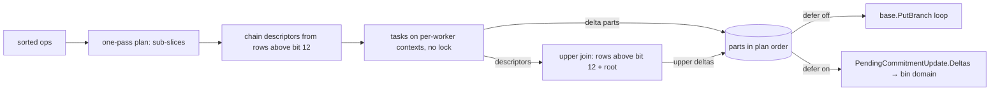

# PBT parallel round that scales

## Overview
- The PBT engine (`execution/commitment/v3/pbt`) already cuts a round by zone × nibble and by storage bucket, and storage
  folds independently of accounts and code. The round still barely scales:
  - tip-like rounds reach 2.13× at 8 workers, re-exec-like rounds 1.96×, convert-like rounds 0.87×;
  - on the arb1-dev mainnet node, the tip bin fold uses 1.24 cores of 8 workers, at 8.6× hex's wall time.
- Two causes, both measured.
  - **Serial work.** 45% of a 100k-op round at 8 workers is serial work that nothing downstream consumes. The join
    re-applies every delta, the merge removes no entry, and every bucket gets a fallback walk from the root that normal
    rounds never use.
  - **One lock.** A single mutex serializes every worker's base read.
- Convert cannot use the round at all, for two reasons:
  - its range writer keeps the rows held between batches in a private overlay that worker contexts cannot see;
  - it feeds sorted batches that each fall inside one partition.
- This plan makes one round serve tip, history re-exec and convert:
  - cut the serial path by following the data;
  - delete the lock;
  - borrow v3's delta parts and grain-sized scheduling;
  - put convert on the same round;
  - add v3's optional deferred branch updates for the bin trie;
  - split verify by partition.
- Evidence: `~/org/mode/e/research/pbt-parallel-convert.org`, facts F13–F18 and ideas I4/I5. The scratch benchmark and
  instrumentation patch sit beside it.

## Context (from discovery)
- Round: `processParallelPhaseA`, `runSubtreeTask`, `runBucketJoin`, `runChainTask`, `preparePhaseTasks`,
  `mergeRoundDeltas` and `phaseContext` in `pbt/parallel_upper.go`. Planner and runner: `buildPhasePlanWithThreshold`,
  `runPhasePlanWithFactory` and `processParallelContext` in `pbt/schedule.go`. Upper join: `processUpperOps` and
  `replaceSubtreeAt` in `pbt/incremental_upper.go`. Plus `addDelta`/`TakeDeltas` in `pbt/delta.go`, and `Process`,
  `write`, `validateOps` and `ResetContext` in `pbt/trie.go`.
- Entry: `registeredTrie.ProcessPBinOps` → `Trie.ProcessParallelContext(ctx, ops, workers)`. Workers come from
  `TrieConfig.WarmupNumWorkersOrDefault` (`TIP_TRIE_WARMUPERS`, default half the CPUs). `processParallelContext` falls
  back to sequential `Process` when `workers == 1` or `len(ops) < 2`. `processParallelPhaseA` runs one worker when no
  factory is installed.
- Factory: `SharedDomainsCommitmentContext.ComputeCommitment` installs `concurrentTrieContextFactory` when
  `paraTrieDB != nil`. Exec enables it for every commitment context, including the bin context in hex+bin mode.
- Deferral is refused for bin in three places:
  - `SharedDomainsCommitmentContext.SetDeferCommitmentUpdates` panics;
  - `computeCommitment` returns `pbinUnsupported("deferred commitment updates")`, pinned by
    `TestPBinComputeCommitmentRefusesDeferredTake`;
  - `stagedsync/exec3.go` `deferCommitmentUpdates` returns false for bin, pinned by
    `TestPBinDeferCommitmentUpdatesExcludesBin`. For hex it is true on fork validation and on parallel block apply.
  The v3 path stores `PendingCommitmentUpdate{Deltas}` from `v3Trie.TakeDeferredDeltas`. The flush goes through
  `TemporalMemBatch.PutOwnedCommitmentBranches`, which hardcodes `kv.CommitmentDomain`.
- Dual committer (`execution/stagedsync/committer.go`): the shadow arm is decorated with `BufferedPatriciaContext` in
  `computeDualFromUpdatesWithRole`. That buffers branch writes, the state record and the drained collector writes.
  `finishDualFolds` replays the buffer only when the shadow root is accepted.
- Convert: `ConvertPBin` (`db/state/pbt_convert.go`) → `PBinRangeWriter.WriteAtBlock` (`db/state/pbt_range_writer.go`).
  - `pbinForEachRebuildOpStream` (`db/state/squeeze.go`) sorts the ops and cuts consecutive ≤ 100k batches.
  - `pbinRangeWriterOverlay` keeps open-path rows between batches (`FlushFinished`).
  - `pbinRowStampTracker` assumes increasing leaf order.
  - Leaf stamps travel in a side file written in leaf order and read sequentially in `visit`.
  - `PBinConvertOptions` carries no DB, and `ConvertPBin` installs no factory.
  - `TestPBinRebuildBatchesFollowTreeKeyOrder` (`squeeze_pbin_rebuild_test.go`) asserts global key order across
    batches.
- Verify: `VerifyPBinDomainRoot` → `pbt.Trie.Verify`, a single-goroutine recursive `verifyRow`. Callers are the
  `cmd/integration` convert and attach checks and `db/integrity`.
- v3 ideas reused:
  - `deltaParts`/`applyDeltas` (`execution/commitment/v3/graph.go`): per-worker chunks, no merge.
  - `SetDeferCommitmentUpdates`/`TakeDeferredDeltas` (`execution/commitment/v3/trie.go`): the round keeps its parts and
    the caller applies them.
  - Storage tasks per account with nibble fan-out at `defaultStorageFanOutMin` = 1024, `storageOversubscribe` = 4, and
    dynamic claiming. The hex fork walk sizes tasks by a grain of `max(128, roundKeys/(4·workers))`.
- Existing tests to keep green and lean on:
  - `TestTrieParallelChurnParity` and `TestVerifyIsReadOnlyAcrossChurnRounds`: the only tests where the bucket fallback
    fires;
  - `TestParallelGlobalJoinDoesNotEncodeChainRowsTwice` and `TestParallelWhaleJoinUsesChildDescriptor`;
  - `TestTrieParallelReopenUpdatesAccountOverflowStorage`, `TestTrieParallelWhaleDeltasAllKeysHaveRoundStartPrev` and
    `TestTrieParallelWhaleDeltasHaveRoundStartPrev`, which read the main trie's `TakeDeltas` after a round.

## Development Approach
- **testing approach**: TDD. A red test is red only when its own assertion fails on the missing behaviour. A compile
  error, a panic before the assert or a fixture mistake does not count. Add no-op methods first when a red test needs
  a new API.
- **Refactor nets.** Tasks 4–6 change structure, not results, so their parity tests pass before and after. Each of
  these tasks adds a mutation check:
  1. copy the changed file to the scratchpad;
  2. break the new path;
  3. run the whole package and name the `file:line` that went red;
  4. copy the file back. Never use `git checkout` on a file with uncommitted work.
- Complete each task fully before the next. Small, focused commits, each subject-only, ≤ 120 characters, with a
  package prefix (`pbt: …`, `commitmentdb: …`, `state: …`, `stagedsync: …`).
- **CRITICAL: every task includes new or updated tests for the code it changes.**
- **CRITICAL: all tests pass before the next task starts.**
- **CRITICAL: update this plan when scope changes.**
- No code comments. Directives, license headers and build tags are fine. New files get the 2026 LGPL header.
- Tests that flip `statecfg.ExperimentalBinCommitment`, `statecfg.BinCommitmentHash`, `commitment.SetPBinHashSuite`
  or an eip8297 hash suite restore them with `commitmentflags.Restore(t)` and never call `t.Parallel`.
- Benchmarks go in `*_bench_test.go`.
- **Oracle rule.** Every round change is checked against sequential `Trie.Process` over the same ops, on root and the
  full record map, never against the parallel round itself. Parity tests install a factory, because without one the
  round runs a single worker.
- **Perf rule.** A task that claims a speedup runs the Task 1 benchmark at its base sha and its head sha in the same
  session, and calls the result through `ab-verdict`. A scheduling knob (Task 10) lands only on a win; a null result is
  recorded here and the change is dropped.
- Never weaken or skip an existing test to get a gate green. When an existing test must change, the task says which
  test and why.

## Testing Strategy
- **unit tests**: required in every task. Correctness is parity against sequential `Process`.
- **race**: from Task 1 on, `go test -race ./execution/commitment/v3/pbt/...` runs on the whole package with a
  per-worker factory. From Task 11, also the `db/state` PBin tests under `-race`.
- **e2e**: none in this area. Convert parity runs through the `db/state` range-writer tests and the `cmd/integration`
  convert tests.
- Gates for every task:
  - build: `go build ./...`
  - test: `go test ./execution/commitment/eip8297/... ./execution/commitment/v3/pbt/... ./execution/commitment/commitmentdb/... ./db/state/...`
  - from Task 11, also `go test ./cmd/integration/commands/...`
  - from Task 12, also `go test ./execution/stagedsync/... -run 'Commit|Dual|Shadow|Defer'`
  - from Task 14, also `go test ./db/integrity/...`
  - lint: `make lint`, repeated until clean, with `GOLANGCI_LINT_CACHE` set to a per-worktree directory.

## Progress Tracking
- Mark completed items with `[x]` immediately.
- Add newly discovered tasks with ➕, blockers with ⚠️.
- Keep the plan in sync with the work actually done.

## Solution Overview
- **The ownership rule** is the one v3 and parallel hex already follow.
  - A worker reads and writes only records under its task's prefix.
  - All workers read one round-start view that nobody writes during the round.
  - Writes come back as deltas and are applied after the join.
  At tip and in re-exec the view is the `SharedDomains` mem batch plus files. Convert must put its held-back rows into
  that view (Task 11).
- **Ownership is derived from the plan.** Each task owns its prefix:
  - a chain owns its 12-bit chain prefix;
  - a bucket owns its 264-bit bucket path;
  - a subtask owns its 268-bit prefix.
  The global join owns everything above the chain prefixes, and a bucket join owns the bucket rows above its subtasks.
  The Task 3 guard reads ownership from the plan, not from a fixed bit count.
- **Serial path, rebuilt from what each step's consumer needs** (F17, F18):
  - **Plan.** Ops are strictly sorted (`validateOps`), so chains, buckets and subtasks are contiguous runs. One scan
    with byte compares replaces the map grouping. Tasks hold full-slice-expression sub-slices. The scan matched the map
    plan on 1,693 of 1,693 plans.
  - **Prepare.** Only chain tasks need an initial descriptor, and it comes from the rows above bit 12. Buckets and
    subtasks read their roots inside their tasks. The root-to-bucket fallback walk goes: about 19,250 per re-exec round,
    used 0 times outside the churn tests. A bucket task with no deltas reports unchanged, and its storage chain keeps
    the cell.
  - **Join.** It reads 0 chain-owned records on every counted corpus. It builds the upper rows from descriptors only,
    with no per-delta apply into `round.records`, `roundPrev` or `t.deltas`. The bucket join stops seeding
    `local.records` and `roundPrev` from child deltas, if Task 3's guard shows it never reads them.
  - **Base write.** Results are v3-style parts, one slice per non-subtask result plus one for the join's upper rows.
    The round applies them with one `PutBranch` loop. There is no merge map, clone or sort: the merge saw 0 duplicates
    and 0 no-ops in 415k deltas, and neither production base depends on order. `TakeDeltas` on the main trie returns
    the flattened parts, so existing tests keep their contract.
- **Lock.** `phaseReadMu` guards nothing in any configuration. Without a factory the round runs one worker, and the
  production factory never returns a nil context. It is deleted, and a nil context from a factory is an error.
- **Prev check.** `phaseContext.PutBranch` reads the base only to check prev. That is the only production check that a
  new row does not overwrite a stored record, so it stays, except on a base that declares itself empty (a fresh
  convert).
- **Scheduling from v3.** Small buckets in one storage nibble are batched into one task, up to a grain. A bucket splits
  into subtasks only above the grain: today the threshold is 8 ops, which gives 19,352 tasks per 100k ops. Tasks keep
  dependencies at lower indexes than their dependents. Chains are not split; a chain straggler in the measurements is
  a new task (➕).
- **Convert.**
  - Worker contexts read the range-writer overlay, which is read-only during a round.
  - Leaf stamps travel with the ops through the sort, replacing the side file.
  - Batches draw `max(1, MaxOps/P)` ops from each of the P live partition cursors.
  - The stamp tracker keeps per-partition state and aggregates the rows above partitions.
  - `ConvertPBin` takes a DB and installs the factory.
- **Deferred updates (v3 parity).** With deferral on, every bin round keeps its parts (sequential `Process` included),
  and the caller applies them to the bin domain. This is what hex already does on parallel block apply and fork
  validation. It moves the base write off the fold, but does not shrink it.
- **Verify.** Each chain subtree is checked on its own pinned worker view, then the rows above bit 12.

## Technical Details
- **Reference baseline (Task 1).** `go test -run '^$' -bench 'BenchmarkParallelRound' -benchtime=5x -count=1
  ./execution/commitment/v3/pbt/` at `3b86c1aed6d` plus the Task 1 test files, on the lock-free per-worker view base.
  Apple M5 Max, 18 logical CPUs, 1M-leaf blake3 trie. Machine load before the run (`top -l 1`): load average
  6.50/3.59/2.64, CPU 80.5% idle. Mean ms/round over 5 rounds (ns/op); w=1 is sequential `Process`. The phase read
  lock is still in place (Task 7 removes it):

  | round | w=1 | w=2 | w=4 | w=8 | w=16 |
  |---|---|---|---|---|---|
  | tip, K=2,000 | 59.8 | 41.0 | 28.4 | 25.4 | 24.7 |
  | re-exec, K=100,000 random | 1421.6 | 930.4 | 710.1 | 613.9 | 588.6 |
  | convert, K=100,000 in one partition | 256.5 | 293.2 | 290.9 | 307.9 | 305.3 |

- Previous measurement, superseded by the table above. It came from a harness whose shared test base serialized reads,
  so it must not be used for before/after. Mac, 18 logical CPUs, 1M-leaf blake3 trie, median ms; w=1 is sequential
  `Process`:

  | round | w=1 | w=2 | w=4 | w=8 | w=16 |
  |---|---|---|---|---|---|
  | tip, K=2,000 | 68.7 | 47.3 | 36.1 | 32.3 | 33.0 |
  | re-exec, K=100,000 random | 1954.8 | 1231.9 | 1053.0 | 995.8 | 961.1 |
  | convert, K=100,000 in one partition | 383.2 | 447.7 | 438.8 | 442.4 | 460.4 |

  At 8 workers, K=100k, the segments were (ms):

  | plan | prep | workers | join apply | `processUpperOps` | merge + base write |
  |---|---|---|---|---|---|
  | 76.6 | 82.1 | 591.1 | 116.2 | 0.2 | 226.6 |

- Grouping keys for the scan (Task 4). Each op is length-checked first: a short key is an error, as `keyPath` gives
  today.
  - chain = (`key[0]`, `key[1]>>4`) for zones 0x00/0x01;
  - bucket = `key[:33]` for 0xFF;
  - subtask = `key[33]>>4` inside a bucket at or above the split threshold, with no drops.
  Drops map as today: a 33-byte account drop goes to its account chain, a storage-prefix drop to its bucket via
  `bucketKeyForPrefix`.
- Delta parts (Task 6): `[][]commitment.BranchDelta`.
  - Each key appears once across the round, by ownership. Tests assert this, as `mergeRoundDeltas` used to enforce.
  - A chain or bucket slice is in its trie's `write` order. A bucket-join slice holds the child deltas first, then the
    bucket's own.
- Partition (Task 11): the Task 4 chain key. Storage partitions are the 16 storage-zone nibbles.
- Convert batches (Task 11):
  - partition starts in the sorted op file are recorded while it is written;
  - a batch takes `max(1, MaxOps/P)` ops from each live cursor, bounded by `MaxBytes`, and never splits a
    `MergeGroupKey` group;
  - the visitor gets one lookahead key per partition, so `FlushFinished` keeps every open path.
- Deferral (Task 12):
  - with deferral on, the trie keeps its parts in a field `ResetContext` does not clear. A round started while parts
    are untaken is an error, checked before the `roundPending` reset;
  - the in-memory root survives until the flush;
  - the context stores `PendingCommitmentUpdate{BlockNum, TxNum, Deltas}`;
  - the flush writes to the context's own commitment domain.

## What Goes Where
- **Implementation Steps** (`[ ]`): code, tests and docs in this repo.
- **Post-Completion** (no checkboxes): measurements on arb1-dev and Hoodi, run by the owner or the supervisor.

## Implementation Steps

### Task 1: Lock-free test base, round benchmark and parity gate

**Files:**
- Create: `execution/commitment/v3/pbt/parallel_round_test.go`
- Create: `execution/commitment/v3/pbt/parallel_round_bench_test.go`

- [x] add a test base whose factory gives each worker a read-only, lock-free view of a frozen record snapshot. Writes
      go only to the main context
- [x] port the scratch grid (`~/org/mode/e/research/pbt-parallel-convert/par-bench_test.go.txt`) onto that base as
      `BenchmarkParallelRound{Tip,Reexec,Convert}`, with sub-benchmarks per workers 1/2/4/8/16 and the same corpus
      shape:
      - 400k account, 100k code, 500k storage leaves;
      - storage in 100k buckets, 8 of them with 20k–50k slots;
      - the base trie built once outside the timer, and each round started from it
- [x] add `TestParallelRoundMatchesSequential` on the same base, with a factory installed: the corpus shapes at small
      size plus a churn corpus with drops, at workers 2/4/8. Compare root and full record map with sequential `Process`
- [x] run `go test -race ./execution/commitment/v3/pbt/...`
- [x] record the benchmark baseline in Technical Details, replacing the orientation table as the reference
- [x] run gates — must pass before Task 2

### Task 2: Convert oracle tests

**Files:**
- Modify: `db/state/pbt_range_writer_test.go`

- [x] take only `db/state/pbt_range_writer_test.go` from `ad6b9a1809d` on `awskii/pbt-stream-rows`. Do not
      cherry-pick: that commit also touches a plan file this branch does not have
- [x] fix its four review findings:
      - compare every bin file raw, as the full key/value sequence in file order, including duplicates and empty
        range files;
      - compare the persisted state bytes, not the in-memory copy;
      - Test B compares state;
      - add a storage split at bit 271 next to the 264 split
- [x] run gates — must pass before Task 3

### Task 3: Join ownership guard and collapse coverage

**Files:**
- Modify: `execution/commitment/v3/pbt/parallel_upper.go`
- Modify: `execution/commitment/v3/pbt/parallel_round_test.go`

- [x] write parity tests first:
      - a round's drops empty one chain, so `normalize` collapses an upper row onto a changed sibling chain;
      - a bucket is emptied under a storage chain;
      - a split bucket loses all but one subtask
- [x] the global join's and each bucket join's contexts refuse `Branch` and `PutBranch` on keys owned by a task of
      the plan. The check runs before the `records` lookup, and the error names the key and the owning task
- [x] write a test that the guard fires: a join hook forcing an owned-key read returns that error
- [x] run gates — must pass before Task 4

### Task 4: One-pass plan over sorted ops

**Files:**
- Modify: `execution/commitment/v3/pbt/schedule.go`
- Modify: `execution/commitment/v3/pbt/schedule_test.go`

- [x] write a property test first, against the current planner, on random corpora with drops and split buckets:
      - every op lands in exactly one task, and each task's ops are a contiguous run of the input;
      - task kinds, prefixes, keys and dependencies equal an independent map-based grouping written in the test;
      - every dependency index is lower than its dependent's
- [x] replace the map grouping in `buildPhasePlanWithThreshold` with one scan, using the Technical Details keys.
      Tasks hold `ops[a:b:b]` sub-slices, with no per-op `keyPath`, `EncodeRowKey` or string keys
- [x] keep buckets ordered largest first within dependency order
- [ ] mutation check, then benchmark before/after through `ab-verdict`
- [x] run gates — must pass before Task 5

### Task 5: Prepare chain descriptors only; buckets read their own roots

**Files:**
- Modify: `execution/commitment/v3/pbt/parallel_upper.go`
- Modify: `execution/commitment/v3/pbt/incremental_upper.go`
- Modify: `execution/commitment/v3/pbt/parallel_round_test.go`

- [x] write parity tests first:
      - removes of absent slots from an existing bucket (this shape reaches the fallback today; same-value rewrites do
        not);
      - a bucket emptied by deletes;
      - a split bucket where one subtask only removes absent slots
- [x] `preparePhaseTasks` computes initial descriptors for chain tasks only. Bucket subtasks read the bucket root from
      its record inside the task
- [x] delete the root-to-bucket fallback walk. A bucket task with no deltas reports unchanged, and the storage chain
      leaves that bucket's cell as is
- [x] confirm `TestTrieParallelChurnParity` and `TestVerifyIsReadOnlyAcrossChurnRounds` pass unchanged. Mutation
      check: make the unchanged path report `present=false`, and the package must go red
- [ ] benchmark before/after through `ab-verdict`
- [x] run gates — must pass before Task 6

### Task 6: Delta parts; no join apply, no merge

**Files:**
- Modify: `execution/commitment/v3/pbt/parallel_upper.go`
- Modify: `execution/commitment/v3/pbt/delta.go`
- Modify: `execution/commitment/v3/pbt/parallel_round_test.go`

- [x] write a test first: a round's parts hold each key once and no entry with Data == Prev, on every Task 1 corpus
- [x] non-subtask results hand over their delta slices without the extra clone (task tries are discarded)
- [x] the global join builds the upper rows from descriptors only. The bucket join drops its seeding of
      `local.records`/`roundPrev` from child deltas if Task 3's guard never fired on them
- [x] after the join, apply the parts in plan order with one `PutBranch` loop. Delete `mergeRoundDeltas`.
      `TakeDeltas` on the main trie returns the flattened parts. The three main-trie `TakeDeltas` tests pass unchanged
- [ ] mutation check; benchmark before/after through `ab-verdict`, and record the remaining base-write share
- [x] run gates — must pass before Task 7

### Task 7: Delete the phase read lock

**Files:**
- Modify: `execution/commitment/v3/pbt/parallel_upper.go`
- Modify: `execution/commitment/v3/pbt/schedule.go`
- Modify: `execution/commitment/v3/pbt/parallel_round_test.go`

- [x] write a test first with a base whose `Branch` blocks until a second concurrent `Branch` arrives (with a
      timeout). It times out under the lock and passes without it
- [x] delete `phaseReadMu`. A factory that returns a nil context fails the round with an error. Test factories that
      return nil are fixed
- [x] run `go test -race ./execution/commitment/v3/pbt/...`
- [ ] benchmark before/after through `ab-verdict`, plus a mutex profile at 8 workers
- [x] run gates — must pass before Task 8

### Task 8: Prev-check read only where the base can hold the record

**Files:**
- Modify: `execution/commitment/v3/pbt/parallel_upper.go`
- Modify: `execution/commitment/v3/pbt/parallel_round_test.go`

- [x] write tests first:
      - on a base that declares itself empty, a convert-like round makes 0 base reads from `phaseContext.PutBranch`
        (a counting base);
      - on an ordinary base, a new row written over a stored record still fails with `previous record mismatch`
- [x] add the empty-base declaration as an optional interface on the base; `phaseContext.PutBranch` skips the read
      only when the base declares it
- [ ] benchmark the convert-like cell before/after through `ab-verdict`
- [x] run gates — must pass before Task 9

### Task 9: Multi-result tasks for batched buckets

**Files:**
- Modify: `execution/commitment/v3/pbt/schedule.go`
- Modify: `execution/commitment/v3/pbt/parallel_upper.go`
- Modify: `execution/commitment/v3/pbt/schedule_test.go`

- [x] write tests first:
      - a task that carries several whole buckets returns one result per bucket;
      - storage chains find each bucket's result;
      - parity over every Task 1 corpus with buckets batched two per task
- [x] give tasks a result range instead of one `resultIndex`; storage chain dependencies resolve per bucket
- [x] add a workers=2 test where every dependent is claimed before its dependencies finish, and the round completes
- [x] run gates — must pass before Task 10

### Task 10: Grain-sized scheduling (from v3)

**Files:**
- Modify: `execution/commitment/v3/pbt/schedule.go`
- Modify: `execution/commitment/v3/pbt/schedule_test.go`

- [ ] write planner tests first:
      - a run of small buckets in one storage nibble becomes one task up to the grain;
      - a bucket splits into subtasks only above the grain;
      - order is largest first within dependency order
- [ ] implement the grain, starting from the hex fork walk's `max(128, roundKeys/(4·workers))`. Compare it with v3's
      1024 fan-out on the benchmark and keep the better
- [ ] try the worker default: half the CPUs (today) against all CPUs, and storage oversubscription like v3's ×4. Land a
      knob only on an `ab-verdict` win; record null results here
- [ ] parity over every Task 1 corpus; run gates — must pass before Task 11

### Task 11: Convert on the shared round

**Files:**
- Modify: `db/state/pbt_range_writer.go`
- Modify: `db/state/squeeze.go`
- Modify: `db/state/pbt_convert.go`
- Modify: `db/state/pbt_leaf_stream.go`
- Modify: `execution/commitment/commitmentdb/commitment_context.go`
- Modify: `cmd/integration/commands/commitment_convert_pbt.go`
- Modify: `db/state/pbt_range_writer_test.go`
- Modify: `db/state/squeeze_pbin_rebuild_test.go`

- [ ] red test first: apply `~/org/mode/e/research/pbt-stream-row-builder/t03-red-test.patch` onto the Task 2 tests.
      It runs the factory-wired variant (4 workers, `WithParaTrieDB`) at `MaxOps` 100k/1k/7/1, and is red today with
      `row 001004 is missing` at batch 2 of `MaxOps=7`
- [ ] leaf stamps travel with each op through the sort, replacing the side file; `visit` no longer reads stamps by
      position
- [ ] `pbinForEachRebuildOpStream` records partition starts and draws batches across partitions (Technical Details).
      Update `TestPBinRebuildBatchesFollowTreeKeyOrder`: order now holds within each partition's cursor. Add a test for
      `MergeGroupKey` groups under partition batching, or record that the range writer never emits merges
- [ ] `FlushFinished` keeps the open path of every live partition. `pbinRowStampTracker` keeps per-partition state and
      a shared aggregate for the rows above partitions, and `finished` clears only the keys it flushed
- [ ] factory contexts read through the range-writer overlay, decorated like the main context and read-only during a
      round. The overlay declares the Task 8 empty base on a fresh convert
- [ ] `PBinConvertOptions` carries the DB, `ConvertPBin` installs the factory, and `convert-pbt` passes it
- [ ] write a test: bin `.kv` files and state are byte-equal between factory and non-factory convert, on the oracle
      corpora and in the `cmd/integration` convert fixture
- [ ] run the `db/state` PBin tests under `-race`; benchmark convert before/after through `ab-verdict`
- [ ] run gates (now including `cmd/integration/commands`) — must pass before Task 12

### Task 12: Optional deferred branch updates for the bin trie (v3 parity)

**Files:**
- Modify: `execution/commitment/v3/pbt/trie.go`
- Modify: `execution/commitment/v3/pbt/parallel_upper.go`
- Modify: `execution/commitment/v3/pbt/register.go`
- Modify: `execution/commitment/commitmentdb/commitment_context.go`
- Modify: `execution/commitment/commitmentdb/pbin_unsupported_test.go`
- Modify: `db/state/temporal_mem_batch.go`
- Modify: `execution/stagedsync/exec3.go`
- Modify: `execution/stagedsync/committer.go`
- Create or modify: tests next to each

- [ ] add no-op `SetDeferCommitmentUpdates`/`TakeDeferredDeltas` on `pbt.Trie`/`registeredTrie`, then write red tests:
      - with deferral on, a parallel round, a one-op round and a workers=1 round each leave the base untouched;
        applying the taken parts gives the same records as inline;
      - a round with untaken parts errors;
      - `RootHash` between the round and the flush returns the new root
- [ ] implement v3's contract on every round path (Technical Details)
- [ ] `PutOwnedCommitmentBranches` writes to the caller's commitment domain instead of the hardcoded
      `kv.CommitmentDomain`. Test: with `WithCommitmentDomain(kv.CommitmentBinDomain)`, the hex domain is untouched
- [ ] commitmentdb accepts deferral for bin through an interface with only those two methods, shared by v3 and pbt.
      Update `pbin_unsupported_test.go` and `TestPBinComputeCommitmentRefusesDeferredTake`: the feature is now
      supported. Test that a canonical-bin context with deferral on gives the same records after the flush as inline
- [ ] `exec3.go`: rewire only. `deferCommitmentUpdates` applies hex's rule to bin, and the existing deferred-flush
      wiring reaches the bin context. No new exec3 mechanism. Update `TestPBinDeferCommitmentUpdatesExcludesBin` with that
      reason. Test a fork-validation round and an unwind across a deferred bin block
- [ ] dual committer: when the shadow arm's trie supports deferral, take its parts after the fold, and apply them
      through the inner context where `Replay` runs today. The buffer stays for the state record and collector drains.
      Clear the parts on every exit (canonical error, cancel, no canonical root). Tests cover each exit and the
      isolated path; shadow root and bin records are equal across the deferred and buffered paths
- [ ] run gates (now including the stagedsync filter) — must pass before Task 13

### Task 13: Verify per partition

**Files:**
- Modify: `execution/commitment/v3/pbt/verify.go`
- Modify: `db/state/pbt_convert.go`
- Modify: `execution/commitment/v3/pbt/verify_test.go`

- [ ] write a red test first: verify on a base whose `Branch` blocks until a second concurrent `Branch` arrives.
      Sequential verify times out
- [ ] write tests: a corrupt row inside one partition, a missing row, and an orphan bucket each report the same error as
      the sequential verify
- [ ] `VerifyPBinDomainRoot` verifies each chain subtree on its own pinned worker view, then the rows above bit 12,
      merging progress and `verifiedBucketKeys`
- [ ] run gates (now including `db/integrity`) — must pass before Task 14

### Task 14: Verify acceptance criteria
- [ ] the benchmark table before (Task 1 baseline) vs after, with `ab-verdict` rows, recorded in Technical Details
- [ ] parity: every Task 1 corpus and the convert oracle tests green with and without a factory
- [ ] `go test -race ./execution/commitment/v3/pbt/...` and the `db/state` PBin tests under `-race`
- [ ] full gates and `make lint` clean

### Task 15: [Final] Update documentation
- [ ] update the PBT notes in `CLAUDE.md` where they name the old behaviour (round ownership, deferral for bin)
- [ ] remove local `~/org` paths from this plan, then move it to `docs/plans/completed/`

## Post-Completion
*Run by the owner or the supervisor on remote hosts; no checkboxes.*

**Measurements:**
- arb1-dev tip: CPU-seconds under `runPhasePlanWithFactory` ÷ bin-fold wall-seconds, against the 1.24 baseline. Take a
  40 s CPU profile with `curl --retry` past Alloy's scrape.
- Hoodi convert wall and CPU, against the single-threaded baseline.
- Mainnet convert on arb1-dev (8C/16T, 125 GB) only on the owner's call. The single-threaded run peaked at 88.4 GB RSS,
  so watch memory per worker.
- A re-exec window (`stage_exec` over a fixed block range) with and without the change.
