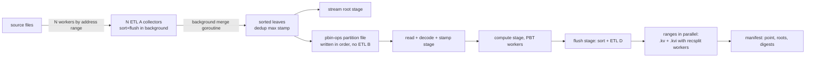

# PBT convert and attach: no re-sort, background ETL merge, parallel phases, progress in the log

## Overview
- On a mainnet-sized state (355M accounts, 3.56B leaves, 16 CPUs), `convert-pbt` takes 8 h 38 min even with
  `--skip-verify`. With verification on, it took 27 h on pruned mainnet, and attach added 14 h. Other clients finish
  in about two hours.
- Measured on glamsterdam-pbt-1 erigon-2 (2026-10-22/23):

  | phase | wall | why |
  |---|---|---|
  | leaf collection | 1 h 25 min | one goroutine walks the source into ETL A |
  | leaf load + re-collect | 2 h 43 min | one goroutine merges A, hashes the stream root, and re-collects every leaf into ETL B, which re-sorts sorted data |
  | B → `pbin-ops-*.bin` | 44 min | one goroutine merges B, no log |
  | fold, 35,687 batches | 2 h 21 min | 75 ms of each 237 ms batch is compute; read, stamp tracker and overlay flush are serial |
  | `.kv` + `.kvi` | 1 h 24 min | ranges one at a time; the 164 GB range's `.kvi` took 49 min |

- Verification makes it worse. The default path re-sorts the full leaf set three more times through ETL:
  - `requirePBinSourceEnd`, only to compare stamps with a bound;
  - `verifyPBTOutputStandalone`, which re-roots the output's hard-linked copy of the same source files;
  - attach, twice: `validatePBTAttachLeafStamps` and `pbtAttachNodePbtRoot`.
  All of them run on one goroutine. `--skip-verify` dropped them and put nothing in their place.
- This plan fixes the pipeline as it is, and the output stays byte-identical:
  - **progress in the log** for every phase, including today's silent merges, the file build and every verify pass;
  - **no re-sort**:
    - ETL B goes, and sorted leaves are written straight into the partition file;
    - the stamp check walks the source unsorted;
    - the output's state files are checked by file identity, not re-rooted;
    - attach checks a digest manifest instead of re-deriving roots;
  - **background ETL merge**: the k-way merge runs on its own goroutine and hands batches to the consumer, so merging
    overlaps the consumer's work;
  - **parallelism**:
    - the source walk and the stamp check by address range;
    - the stream root on its own stage;
    - the fold loop as three overlapped stages (read/stamp, compute, flush);
    - file ranges and their recsplit indexes built concurrently;
    - attach digests.
- `--skip-verify` is deleted: with these changes, verification no longer costs hours. `verify-pbt` keeps the full
  independent passes for hive, CI and operators who want them.
- Evidence: `~/org/mode/e/research/pbt-fast-migration.org` (F1–F11) and its code maps, which gpt-6-astra max checked
  claim by claim (5 HOLDS, 5 PARTLY, no counterexample).

## Context (from discovery)
- Convert: `convertPBTWithOptions` (`cmd/integration/commands/commitment_convert_pbt.go`) → `ConvertPBin`
  (`db/state/pbt_convert.go`).
  - `ForEachPBinLeaf` (`db/state/pbt_leaf_stream.go`) runs three `DomainLatestIterFile` cursors with no key bounds,
    on one goroutine, and collects into ETL A (`pbin-leaf-stream`) in the source `temp/`. `pbinLoadSortedLeaves`
    merges A, dedups (max stamp, equal value) and emits sorted leaves.
  - `PBinRootFromStream` (`eip8297.StreamRootBuilder`) and `PBinRangeWriter.WriteAtBlock` (`pbt_range_writer.go`)
    consume the same stream.
  - `pbinForEachRebuildOpStream` (`db/state/squeeze.go`): ETL B (`[rebuild_commitment_pbin]`, keyed by
    `batchOperationKey`, equal to the leaf key here) → `pbin-ops-*.bin` with a 12-bit partition offset table →
    round-robin batches (`maxOps/len(live)` per partition) → `visit`.
  - The other caller is `import-pbt`, whose artifact leaves are already in tree-key order.
  - `visit` runs `tracker.observe/advance`, then `ComputeCommitmentWithDiff` (PBT workers), then the serial
    `[concurrent_branch]` drain, then `pbinRangeWriterOverlay.FlushFinished` (sort, `onRow` → stamp → ETL D per
    range).
  - `buildFiles` builds the ranges in a loop: ETL D `Load` → `seg.Compressor` (`.idt`, then `.kv`) →
    `buildFileRange` (`.kvi`; recsplit workers only from `COMPRESS_WORKERS`) → `integrateDirtyFiles`.
  - Verify: `requirePBinSourceEnd` (C-a, a sorted leaf walk used only for a stamp bound), the engine root vs stream
    root (C-b), the header root after the fork (C-c), `verifyPBTOutputRows` → `VerifyPBinDomainRoot` (C-d, already
    parallel by `PBT_WORKERS` over chains ≥ 12 bits), and `verifyPBTOutputStandalone` → `PBinStateRoot` (C-e).
  - Output state files are hard links of the source's (`linkSnapshotsExceptCommitment`).
- Attach: `attachPBTWithHooks` (`commitment_attach_pbt.go`).
  - Content passes:
    - A-a, `validatePBTAttachLeafStamps`: a sorted leaf walk that yields the published leaf root;
    - A-b, `verifyPBTAttachPublishedBin`: `VerifyPBinDomainRoot`;
    - A-c, `pbtAttachNodePbtRoot`: a sorted walk of the node's state, fresh attach only.
  - Cheap checks: the node hex root against the published hex root, the header at a block end, salts, genesis,
    layout, and the state records.
  - Then `adoptPBTFiles` (`linkOrCopyPBTFile`, file set from `pbtAttachAdoptsFile`), `resetPBTExecution`, the shadow
    root, and `WriteErigonDBSettings`. Nothing hashes file bytes.
- ETL (`db/etl/collector.go`): `SortAndFlushInBackground` overlaps one sort/flush per collector. `Load` →
  `mergeSortFiles` is a heap merge on the caller goroutine that calls `loadFunc` inline. `MergeLoad` merges several
  collectors in one heap. No background merge exists.
- `--skip-verify` is commit `2c2060ec29d`. Its tests are in `commitment_convert_pbt_test.go` and
  `commitment_attach_pbt_test.go`.
- Docs naming today's pipeline: `docs/pbt-migration.md`, `cmd/integration/Readme.md`, and the root
  `CLAUDE.md`/`AGENTS.md` PBT paragraph.
- Conventions: no code comments (hook-enforced); `*Func` for function types; no Factory/Builder/Manager names; new
  files carry the 2026 license header; commit subjects ≤ 120 chars; no line numbers in docs.

## Development Approach
- **testing approach**: TDD.
  - The safety net is output identity. Every task keeps the converter's output byte-identical (the bin `.kv` file
    set, the record maps, and range placement) to the pre-change converter on the test corpora.
  - Task 1 adds that check.
  - New behaviour gets a test that fails on its assertion first; signatures land before their tests.
- complete each task fully before moving to the next; small focused commits.
- **CRITICAL: every task MUST include new/updated tests** for code changes in that task, success and error paths.
- **CRITICAL: all tests must pass before starting next task** — the gate below, every task.
- **CRITICAL: update this plan file when scope changes during implementation**.
- Every change is on the production path (`convert-pbt`, `attach-pbt`, `import-pbt`, `verify-pbt`). Tests drive it
  through those entry points or the functions they call, and a concurrency test asserts that the stage actually
  runs with more than one goroutine.
- Gate per task:
  - `go build ./...`, `make lint`;
  - `go test` of `./db/etl/...`, `./db/state/...`, `./db/integrity/...`, `./db/seg/...`, `./db/recsplit/...`,
    `./execution/commitment/v3/pbt/...`, `./cmd/utils/app/...` and `./cmd/integration/commands/...`
    (`-timeout 30m`);
  - `go test -race ./db/etl/ ./db/state/ -run 'PBin|Background|Parallel'`.

## Testing Strategy
- **Output identity** (Task 1, kept green by every task): a golden harness converts state-level corpora and compares
  the result to golden data recorded from the pre-change converter. The golden data is the bin file names, every
  file's (key, value) sequence, and the root. Corpora:
  - accounts with header slots;
  - code shared across many accounts;
  - small and large storage buckets;
  - empty zones; a single account;
  - multiple account-file ranges, with a past-frontier range when the source allows one.
  Both `--keep-hex` and bin-only, keccak and blake3. They reuse `newPBTConversionSource*`,
  `pbtAcceptanceReferenceEntries` and `writePBinConvertStateN`.
- **Concurrency**: each parallel stage exposes its worker count through the progress line or a counter that a test
  reads, and `-race` runs on the touched packages.
- **Detection**: each case must give its own named error:
  - a stamp past the point in any address range;
  - a changed byte, a missing, extra or resized file, or a wrong root in the manifest or the published files;
  - a corrupted copy in attach;
  - a hard-linked output state file that is not the source's inode.
- **Progress**: a log-capture test with a short interval asserts that every phase logs a progress line with
  done/total and rate.
- **Scale** (benchmark): a ≥ 100M-leaf generated datadir; per-phase wall time and CPU-seconds at workers 1/4/8/16.

## Progress Tracking
- mark completed items with `[x]` immediately when done
- add newly discovered tasks with ➕ prefix
- document issues/blockers with ⚠️ prefix
- update plan if implementation deviates from original scope

## Solution Overview

- **D1 — output identity is the contract.** No change touches row content or range placement. The golden harness
  proves it after every task.
- **D2 — no re-sort anywhere.**
  - ETL B is replaced by an in-order writer of the partition file, which fails if its input is out of order.
  - C-a walks the source in parallel without sorting.
  - C-e becomes a file-identity check: every output state file is the source file's inode, plus the state records
    at the point. That holds because C-b already roots exactly those bytes.
  - Attach replaces A-a and A-c with the manifest, the node hex root against the manifest hex root (already
    checked), and the root record.
- **D3 — background merge lives in `db/etl`.** It is `Collector.MergeInBackground(true)`, symmetric with
  `SortAndFlushInBackground`, and also available to `MergeLoad`. A goroutine runs the heap merge into a ring of
  batches, and `loadFunc` consumes them on the caller. Order, errors and cancellation behave exactly as the
  serial merge does.
- **D4 — parallel source walk.** N workers walk disjoint address ranges with `DebugRangeLatestFromFiles(from, to)`.
  Each feeds its own ETL A collector, and the collectors are merged in the background with `MergeLoad`. Dedup at
  load stays as today, so the leaf set and its stamps are unchanged.
- **D5 — fold loop pipeline.** Stage 1 reads and decodes the next batch from the partition file and runs
  `tracker.observe/advance`; it is in order and single-goroutine. Stage 2 is `ComputeCommitmentWithDiff`. Stage 3 is
  the flush. `FlushFinished` splits into a synchronous detach of the finished rows, which the next compute must not
  see in the overlay, and a background sort plus ETL D collect of the detached rows. Each stage runs one batch
  ahead of the next, so a batch's wall time approaches its slowest stage.
- **D6 — files in parallel.** `buildFiles` builds every range concurrently. Recsplit workers are set from
  `--workers` and split by range size. Concurrent builds are capped by memory. `integrateDirtyFiles` runs at the
  end.
- **D7 — manifest, and no `--skip-verify`.**
  - Convert writes `snapshots/pbt-manifest.toml` last, after its checks pass (temp, fsync, rename):
    - point, `pbt_root`, `hex_root`, `trie_hash`, `format = 1`;
    - name, size and blake3 of every file `pbtAttachAdoptsFile` selects.
  - Attach verifies the digests in parallel, plus the root record, the point and the hex root. A file adopted by copy
    is digested again at the destination.
  - Outputs without a manifest are refused with "re-run convert-pbt with this binary".
  - `verify-pbt` runs C-d, C-e (`PBinStateRoot`) and the manifest check.

## Technical Details
- **Partition file writer** (replaces ETL B in `pbinForEachRebuildOpStream`):
  - writes length-prefixed op records in arrival order;
  - opens a new partition offset whenever `pbinPartitionOf(key)` changes;
  - rejects a key ≤ the previous key;
  - keeps the batch cutter and `visit` unchanged.
  `import-pbt`'s stream is sorted already; a test pins that.
- **Background merge**: a batch is up to 4096 entries or 4 MB, with keys and values copied into the batch's arena.
  The ring holds 4 batches, and memory is reported. `loadFunc` errors stop the merge goroutine.
- **Parallel C-a**: `--workers` address ranges, each an unsorted walk that stops at the first stamp > txNum and
  reports it.
- **Progress lines**, at least every 30 s:
  - phase, done/total, rate, ETA, RssAnon, Go heap and temp bytes;
  - ETL merges report entries merged out of total;
  - the fold reports batches and leaves done, with the per-stage busy share;
  - files report per range and stage (`.idt`, `.kv`, `.kvi`);
  - verify and attach report bytes or rows done.
- **Flags**:
  - `convert-pbt` adds `--workers` (default `PBT_WORKERS`) and loses `--skip-verify`;
  - `attach-pbt` loses `--skip-verify`;
  - new `integration commitment verify-pbt --datadir`.

## What Goes Where
- **Implementation Steps**: code, tests, and the docs in this repo.
- **Post-Completion**: the arb1-dev mainnet run, hive on snap-arb1, and the devnet rollout.

## Implementation Steps

### Task 1: Output-identity golden harness
**Files:**
- Create: `cmd/integration/commands/commitment_convert_pbt_golden_test.go`
- Create: `cmd/integration/commands/testdata/pbt-convert-golden/` (generated)

- [x] state-level corpora (Testing Strategy) and a `-update` path that records the golden data from the current
      converter.
- [x] the comparison test: file names, per-file (key, value) sequence, root, and both modes. It passes on its first
      run, as a characterization test.
- [x] mutation check: perturb one row's range placement in a scratch copy of the writer and confirm the test goes red
      on the placement assertion; then restore the copy.
- [x] run the gate — must pass before Task 2.

### Task 2: Progress in the log for every phase
**Files:**
- Modify: `db/etl/collector.go`, `db/etl/etl.go`, `db/state/pbt_leaf_stream.go`, `db/state/squeeze.go`,
  `db/state/pbt_range_writer.go`, `db/state/pbt_convert.go`, `cmd/integration/commands/commitment_convert_pbt.go`,
  `cmd/integration/commands/commitment_attach_pbt.go`, `cmd/integration/commands/commitment_attach_pbt_test.go`
- Create: `db/state/pbt_progress.go`, `db/state/pbt_progress_rss_linux.go`, `db/state/pbt_progress_rss_darwin.go`,
  `db/state/pbt_progress_rss_other.go`, `db/state/pbt_progress_test.go`

- [x] one progress helper shared by all phases: interval, done/total, rate, ETA, memory and temp.
- [x] wire it into the ETL merge (via `TransformArgs`), the partition-file write, the fold, each range's file stages,
      every verify pass, and attach.
- [x] log-capture test with a short interval: every phase emits a line.
- [x] run the gate — must pass before Task 3.

### Task 3: Background ETL merge
**Files:**
- Modify: `db/etl/collector.go`
- Create: `db/etl/merge_background.go`
- Create: `db/etl/merge_background_test.go`

- [x] `MergeInBackground(true)` on `Collector`, plus the `MergeLoad` equivalent. The test is written first: random
      data, many spill files, and in-RAM providers, and the background merge must give exactly the serial order.
- [x] tests: a `loadFunc` error stops the goroutine with no leak; context cancel stops it; an empty collector; one
      provider.
- [x] enable it on ETL A in `pbinLoadSortedLeaves`.
- [x] run the gate — must pass before Task 4.

### Task 4: No re-sort in the fold input
**Files:**
- Modify: `db/state/squeeze.go`
- Modify: `db/state/squeeze_pbin_rebuild_test.go`

- [x] test first: an out-of-order stream fails with a named error. Today it is silently sorted.
- [x] replace ETL B with the in-order partition-file writer; batches and `visit` are unchanged.
- [x] tests: the batches equal the old path's on the existing corpora; `import-pbt`'s stream passes the order check;
      the golden harness stays green.
- [x] run the gate — must pass before Task 5.

### Task 5: Parallel source walk and stream-root stage
**Files:**
- Modify: `db/state/pbt_leaf_stream.go`
- Modify: `db/state/pbt_convert.go`
- Create: `db/state/pbt_leaf_stream_parallel_test.go`

- [ ] N address-range walkers, each with its own ETL A collector, merged with background `MergeLoad`. The worker
      count comes from `--workers`.
- [ ] `PBinRootFromStream` runs as its own stage beside the partition-file writer, fed from the same merged stream.
- [ ] tests: the leaf set and stamps equal the serial walk's for workers 1/4/16, shared code across ranges included;
      the concurrency counter is > 1; the golden harness stays green.
- [ ] run the gate — must pass before Task 6.

### Task 6: Fold loop pipeline
**Files:**
- Modify: `db/state/squeeze.go`, `db/state/pbt_range_writer.go`
- Create: `db/state/pbt_range_writer_pipeline_test.go`

- [ ] split `FlushFinished` into detach (synchronous) and collect (background).
- [ ] the three-stage pipeline of D5, with errors propagating from any stage and stopping the others.
- [ ] tests: equal output to the serial loop on corpora with `MaxOps` 7, 1000 and 100000; an error in each stage;
      the golden harness stays green; `-race`.
- [ ] run the gate — must pass before Task 7.

### Task 7: Parallel file ranges and indexes
**Files:**
- Modify: `db/state/pbt_range_writer.go`
- Modify: `db/state/pbt_range_writer_test.go`

- [ ] build all ranges concurrently, with recsplit workers from `--workers` split by range size, a memory cap on
      concurrent builds, and one `integrateDirtyFiles` at the end.
- [ ] tests: identical files at workers 1 and 16; a failure in one range removes every partial file; the golden
      harness stays green.
- [ ] run the gate — must pass before Task 8.

### Task 8: Verify without re-sorting; manifest; no `--skip-verify` in convert
**Files:**
- Create: `db/state/pbt_manifest.go`, `db/state/pbt_manifest_test.go`
- Modify: `cmd/integration/commands/commitment_convert_pbt.go`
- Modify: `cmd/integration/commands/commitment_convert_pbt_test.go`

- [ ] C-a as a parallel unsorted stamp walk. C-e as file identity: every output state file has the source file's
      inode, plus the state records at the point. C-b, C-c and C-d stay as they are.
- [ ] the manifest (D7): write it last; read; check with parallel digests.
- [ ] delete `--skip-verify`, `requirePBinSourceFilesEnd`, and their tests.
- [ ] tests: a stamp past the point in the last address range; a non-linked output state file; manifest round trip
      and every tamper case; the golden harness stays green.
- [ ] run the gate — must pass before Task 9.

### Task 9: attach-pbt verifies the manifest
**Files:**
- Modify: `cmd/integration/commands/commitment_attach_pbt.go`
- Modify: `cmd/integration/commands/commitment_attach_pbt_test.go`

- [ ] require the manifest (named error for old outputs), and check:
  - the point, `trie_hash` and file set;
  - the digests in parallel;
  - the root record against `pbt_root`;
  - the published and node hex roots against `hex_root`;
  - past the fork, the header root against `pbt_root`.
  Re-digest a file adopted by copy at the destination.
- [ ] delete `--skip-verify`, A-a, A-b and A-c from the default path. Write the shadow root from `pbt_root` at a block
      end before the fork. Copy the manifest into the node.
- [ ] tests:
  - refused before adopting: a changed byte; a missing or extra file; a wrong root; a wrong hex root;
  - a corrupted copy is refused after the copy;
  - a clean attach writes the shadow root and settings;
  - resume after a crash at each `hooks.step`.
- [ ] run the gate — must pass before Task 10.

### Task 10: verify-pbt command
**Files:**
- Create: `cmd/integration/commands/commitment_verify_pbt.go`
- Create: `cmd/integration/commands/commitment_verify_pbt_test.go`

- [ ] move C-d (`VerifyPBinDomainRoot`) and C-e (`PBinStateRoot` against the state record) here. Run the manifest
      check when a manifest is present.
- [ ] tests: a clean converted datadir passes; corrupted rows, leaves and files each fail with their error.
- [ ] run the gate — must pass before Task 11.

### Task 11: Scale benchmark
**Files:**
- Create: `db/state/pbt_convert_bench_test.go`

- [ ] `BenchmarkPBinConvert` on a ≥ 100M-leaf generated datadir: per-phase wall time, CPU-seconds and RssAnon at
      workers 1/4/8/16.
- [ ] record the numbers in the plan and the research log.
- [ ] run the gate — must pass before Task 12.

### Task 12: Verify acceptance criteria
- [ ] every Overview item is implemented and reached from `convert-pbt`, `attach-pbt` or `verify-pbt`.
- [ ] Hoodi real data on the Mac (`/Volumes/dev/chains/hoodi-pbt/`, offline clone):
  - bin files identical to the pre-change converter's;
  - attach on a clone, then dual re-execution over ≥ 1000 blocks with no shadow stop;
  - `verify-pbt` passes;
  - per-phase wall time recorded.
- [ ] full gate, `go test -race` on the touched packages, and `make lint`.

### Task 13: [Final] Update documentation
- [ ] `docs/pbt-migration.md`: the pipeline, the manifest, attach's checks, `verify-pbt`, and the removed flag.
- [ ] `cmd/integration/Readme.md`: convert, attach and verify usage.
- [ ] root `CLAUDE.md`/`AGENTS.md` PBT paragraph, where the convert sentence changes.
- [ ] move this plan to `docs/plans/completed/`.

## Post-Completion
*Items requiring manual intervention or external systems — informational only*

**Mainnet measurement** (arb1-dev, `/erigon-data/pbt-min/src`, 3.0B leaves, 8C/16T, 125 GB; the owner's call):
- per-phase wall time against the erigon-2 table above and against pbt-mainnet-convert-dual F5 (27 h 05 min +
  13 h 56 min);
- bin files identical to the old converter's at the same point.

**Conformance**: hive `pbt-artifacts` on snap-arb1, 231/0 as before.

**Next lever, if the totals stay above ~2 h**: the fold stays serial in its batch cutter, and the stream root is one
goroutine. A partitioned bulk build is research-log idea I1: the engine per partition, one spill, and rows straight
into the range files. It replaces both, and needs its own plan.

**Rollout**: scripts that pass `--skip-verify` (erigon-2 `migrate-2.sh`) must drop it. Outputs without a manifest
are refused, and convert must be rerun.
